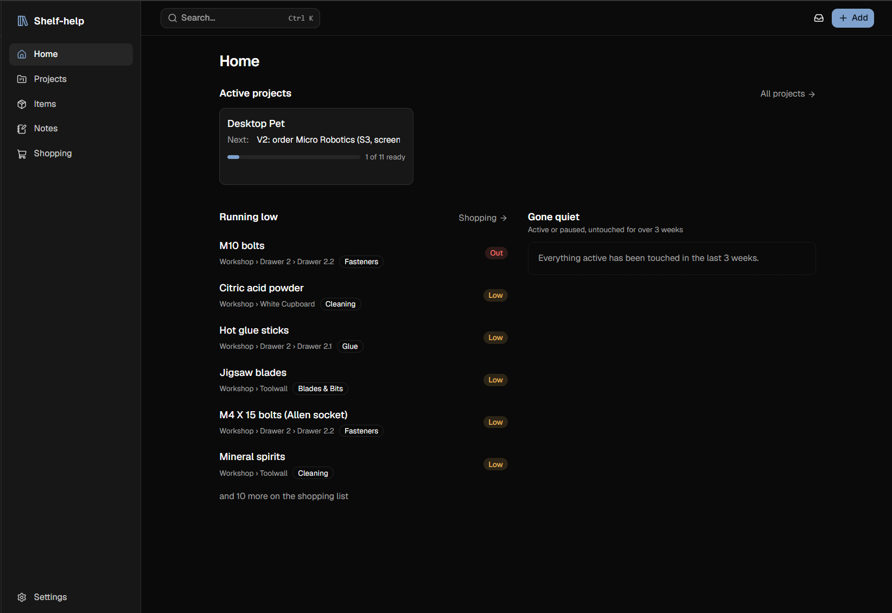
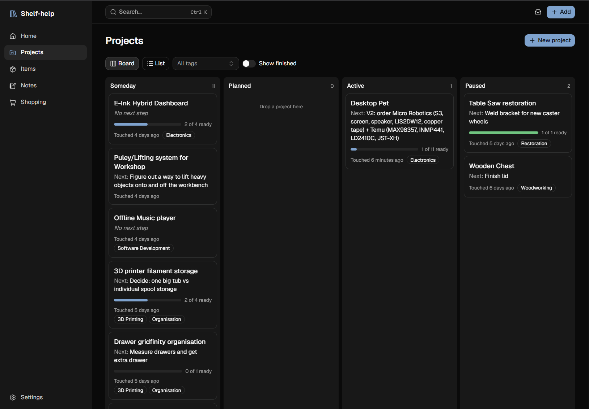
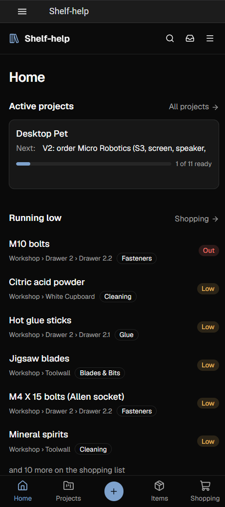

<p align="center">
  
</p>

# Shelf-help

A personal project, item and notes manager that runs as a self-hosted **Home Assistant add-on**.

It keeps track of hobby and household projects (active ones and "someday" ideas), the tools and parts they need, where those things are kept, and the notes that go with them. Claude can also read and update it through a built-in **MCP server**.

Dashboard


Project board


Dashboard on mobile




## Why

Paper notes and loose lists get lost. A tool like this only helps if adding things is quick and it's worth opening regularly, so every feature is judged on that:

- **Capture is fast.** Quick-add needs only a type and a name. Everything lands in an inbox to sort later.
- **Items stand on their own.** A tool or part is created once and then *linked* to as many projects as need it.
- **Little upkeep.** No quantity tracking: an item is Have, Low, Out or Need to get. Project readiness and the shopping list are computed, never stored, so they're always up to date.
- **It shows what to do next.** Every project has a next step and a last-touched date, so stalled projects stand out.

## Features

- **Projects:** a board with drag-and-drop between statuses (someday → planned → active → paused → done), a list view, tags, an editable next step, and a readiness bar showing how many required items are on hand
- **Items:** parent/child parts (table saw → blade), a location tree, tags, and shops they can be bought from. Items pick up their location's tags automatically
- **Notes:** a rich markdown editor (TipTap), stored as plain markdown and checked by round-trip tests
- **Shopping list:** everything Low, Out or Need to get, grouped by zone (Home, Workshop…) or filtered by shop, with one-tap "Got it" and undo
- **Dashboard:** active projects with their next steps, items running low, and projects that have "gone quiet"
- **Inbox and quick-add:** capture now, sort later
- **Global search:** a Ctrl+K command palette backed by SQLite FTS5
- **Links and file attachments** on projects, items and notes (manuals, datasheets)
- **Responsive:** a sidebar on desktop and a bottom bar on mobile. Works inside the Home Assistant companion app
- **AI integration (MCP):** 27 task-shaped tools let Claude Code, Claude Desktop or any other AI agent search, create and update projects, items and notes

## Tech stack

| Layer | Choice |
|---|---|
| Backend | Python 3.12, FastAPI, SQLAlchemy 2.0, Pydantic, Alembic |
| Database | SQLite with FTS5 full-text search |
| Frontend | React, TypeScript, Vite, TanStack Query |
| UI | shadcn/ui (Radix + Tailwind), dnd-kit, TipTap |
| API client | Generated from FastAPI's OpenAPI spec with orval: no hand-written API types |
| Testing | pytest, Vitest |
| Tooling | uv, npm, Ruff, ESLint, Prettier, Podman |
| Hosting | Home Assistant add-on (Docker), served through HA Ingress |

## Architecture

```
Browser / HA companion app
        │  (HA login)
        ▼
Home Assistant Ingress ──► one container: FastAPI
                             ├─ /api/*   REST API
                             ├─ /mcp     MCP server (Claude)
                             └─ /*       built React app
                                   │
                                   ▼
                     /data: SQLite + attachments (in HA backups)
```

Points worth noting:

- **One container.** FastAPI serves both the API and the built frontend.
- **Works under a changing path prefix.** Ingress serves the app under a per-session path. The backend injects that base path into `index.html` at request time, and the frontend uses only relative asset paths.
- **Access is by the connection's real address.** Requests from HA's Ingress gateway are already authenticated by Home Assistant. Anything else, through the optional direct LAN port, can reach only `/mcp`, and only with a bearer token compared in constant time. Proxy headers are ignored, so they can't be spoofed (`backend/app/core/access.py`).
- **Feature modules.** Each feature has its own backend module (`models`, `schemas`, `router`, `service`) and its own frontend folder. Business rules live in the service layer and routers stay thin.
- **Safe upgrades.** Every schema change is an Alembic migration, applied automatically when the add-on starts. A test fails if the models drift from the migrations.
- **Safe backups.** All data lives in `/data`, and the add-on uses cold backups so the SQLite file is never copied mid-write.

## Running it locally

Needs Python (via [uv](https://docs.astral.sh/uv/)) and Node.js.

```bash
# Backend (http://localhost:8099)
cd backend
uv sync
uv run alembic upgrade head
uv run uvicorn app.main:create_app --factory --reload --port 8099

# Frontend dev server (proxies /api to the backend)
cd frontend
npm install
npm run dev
```

Tests and checks:

```bash
cd backend && uv run pytest && uv run ruff check .
cd frontend && npm test && npm run lint
```

## Installing on Home Assistant

1. Clone this repo into `/addons` on your Home Assistant OS host.
2. In Home Assistant, go to **Settings → Add-ons → Add-on store → Local add-ons** and install **Shelf-help**.
3. Start it and open it from the sidebar.

To let Claude connect, set a host port for 8099 in the add-on's Network settings. Then copy the token and the ready-made setup from **Settings → Claude** in the app.

## Documentation

The design docs live in [`docs/`](docs/):

- [Project overview](docs/project-overview.md): principles, stack, hosting
- [Data model](docs/data-model.md)
- [Pages and components](docs/pages.md)
- [MVP scope and build order](docs/mvp.md)
- [Future enhancements](docs/future-enhancements.md)

## Status

V1 is complete and in daily use (v1.2.0). It's a personal project, so outside contributions aren't being accepted. Feel free to look around.
